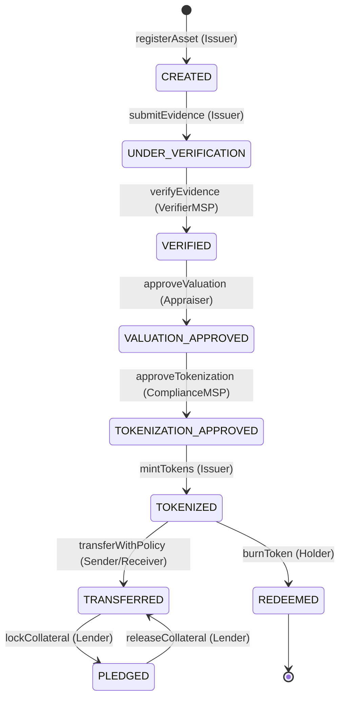

# RFC 001: TESSERA Verifiable Real-World Asset (RWA) Tokenization Protocol

**Status**: Accepted  
**Author**: TESSERA Architecture Committee  
**Target Environment**: Hyperledger Fabric v2.5 LTS + Node.js Backend + React/Vite Console  
**Date**: October 2026  

---

## 1. Executive Summary

Existing Real-World Asset (RWA) tokenization implementations suffer from an "off-chain oracle and verifiability gap": tokens are minted on public or private networks without cryptographic linkage to immutable, tamper-evident physical inspection proofs, licensed valuation appraisals, or consortium-enforced maker-checker governance.

**TESSERA** resolves this gap by providing an end-to-end verifiable tokenization pipeline on Hyperledger Fabric. Every asset lifecycle transition—from raw physical registration through independent physical verification, dual-appraiser valuation consensus, and compliance sign-off—is committed to an immutable permissioned ledger with cryptographic evidence anchoring.

---

## 2. Multi-MSP Consortium Architecture

TESSERA distributes authority across distinct Membership Service Providers (MSPs) to eliminate single points of compromise:

| Organization MSP | Role in Network | Responsibilities | Endorsement Power |
|:---|:---|:---|:---|
| **IssuerMSP** | Asset Originator | Asset creation, evidence submission, minting initiation | Maker (Cannot verify own assets) |
| **VerifierMSP** | Independent Inspector | Physical inspection, title verification, evidence attestation | Checker 1 (Required for VERIFIED state) |
| **ComplianceMSP** | Regulatory Officer | AML/KYC checks, jurisdiction whitelisting, sanctions screening | Checker 2 (Required for TOKENIZATION_APPROVED) |
| **GovernanceMSP** | Consortium Oversight | Transfer policy lifecycle, emergency halts, 2-of-3 quorum | Quorum Authority |
| **AuditorMSP** | Independent Auditor | Read-only ledger audit, passport cryptographic validation | Non-endorsing auditor |

```
                       [ Consortium Governance ]
                                   │
              ┌────────────────────┼────────────────────┐
              ▼                    ▼                    ▼
       [ IssuerMSP ]       [ VerifierMSP ]      [ ComplianceMSP ]
      (Origin / Mint)     (Inspection Proof)   (Sanctions & KYC)
              │                    │                    │
              └────────────────────┼────────────────────┘
                                   │
                                   ▼
                    [ Fabric Raft Ordering Service ]
                                   │
                         [ World State / PDC ]
```

---

## 3. Strict State Machine Lifecycle

Assets transition through deterministic lifecycle phases. No phase can be skipped:



### Lifecycle Gate Invariants

1. **Gate 1 (Creation to Verification)**: An asset cannot enter `VERIFIED` until at least one high-confidence title or inspection document is cryptographically anchored and signed by `VerifierMSP`.
2. **Gate 2 (Verification to Valuation)**: Only verified assets can receive certified valuations. Valuations must adhere to a valid template (e.g. `equipment`, `vehicle`, `land`, `grain`).
3. **Gate 3 (Valuation to Tokenization Approval)**: Segregation of duties mandates that the tokenization approval must come from `ComplianceMSP` or `GovernanceMSP`, never `IssuerMSP`.
4. **Gate 4 (Minting)**: Token supply minted must match the approved valuation unit conversion specified in the asset template.

---

## 4. Cryptographic Evidence Anchoring & Private Data Collections

Physical documents (deeds, inspection certificates, lab assay reports) are stored in off-chain object storage (MinIO/S3 compatible) and pinned cryptographically to Hyperledger Fabric:

1. **SHA-256 Digest**: The raw file buffer is hashed:
   $$\text{Digest} = \text{SHA-256}(\text{Buffer})$$
2. **Private Data Collection (PDC)**: Sensitive metadata (e.g., owner PII, appraisal methodologies) is submitted to an MSP-restricted PDC (`_implicit_org_VerifierMSP`).
3. **On-Chain Commitment**: The SHA-256 hash, submitter MSP, and timestamp are committed to the public channel state:
   $$\text{EvidenceCommitment} = (\text{evidenceId}, \text{sha256}, \text{submittedByMSP}, \text{txId})$$

---

## 5. Verifiable Asset Passport Specification

Each tokenized asset exposes an authoritative **Asset Passport** conforming to RFC 8785 (JSON Canonicalization Scheme):

```json
{
  "$schema": "https://tessera.network/schemas/passport-v1.json",
  "passportVersion": "1.0.0",
  "assetId": "VEH-2025-001",
  "canonicalIdentity": {
    "vin": "1HGCR2F83HA000123",
    "country": "US",
    "registry": "National Motor Vehicle Title Information System"
  },
  "lifecycle": {
    "currentState": "TOKENIZED",
    "history": [
      { "state": "CREATED", "txId": "7f8a9...b1", "timestamp": "2026-10-10T12:00:00Z" },
      { "state": "VERIFIED", "txId": "3c2d1...e4", "timestamp": "2026-10-11T14:30:00Z" },
      { "state": "TOKENIZED", "txId": "9b0a1...f2", "timestamp": "2026-10-12T09:15:00Z" }
    ]
  },
  "signatures": [
    {
      "signerMSP": "VerifierMSP",
      "signature": "MEQCIAz7...qA=="
    },
    {
      "signerMSP": "ComplianceMSP",
      "signature": "MEQCIQD8...rB=="
    }
  ]
}
```

---

## 6. Security Considerations & Threat Model

- **Sybil Resistance**: All transactions must be endorsed by X.509 cryptographic identities issued by consortium Root CAs.
- **Tamper Evidence**: Changes to on-chain state require transaction block inclusion with Raft crash fault tolerance.
- **Maker-Checker Invariant**: Backend middleware (`backend/src/middleware/authorize.middleware.js`) strictly verifies that `req.user.organization !== asset.ownerMSP` for all verification and approval routes.
